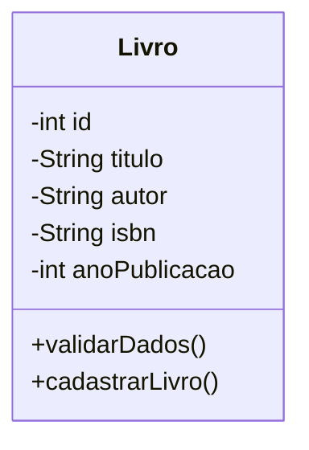

# Sistema de Gerenciamento de Biblioteca

**Atividade 03 — Desenvolvimento Ágil e Prática de XP**
**Dev 1 — Análise e Projeto**

| Item | Detalhe |
|---|---|
| User Story | US01 — Cadastrar Livros |
| Prioridade | Prioritária |
| Peso (planning poker) | 3 — complexidade média |

## 1. Objetivo

Realizar a análise e a modelagem da funcionalidade de cadastro de livros, definindo os requisitos, os atributos, as regras de negócio e a estrutura necessária para orientar a implementação.

## 2. User Story

> **COMO** bibliotecário,
> **EU QUERO** cadastrar livros informando título, autor, ISBN e ano de publicação,
> **PARA QUE** os livros possam ser registrados e organizados no sistema.

## 3. Levantamento de requisitos

### 3.1 Requisitos funcionais

| ID | Requisito |
|---|---|
| RF01 | O sistema deve permitir cadastrar um novo livro. |
| RF02 | O sistema deve solicitar título, autor, ISBN e ano de publicação. |
| RF03 | O sistema deve validar o preenchimento dos campos obrigatórios. |
| RF04 | O sistema deve impedir o cadastro de livros com ISBN duplicado. |
| RF05 | O sistema deve atribuir um identificador único a cada livro. |
| RF06 | O sistema deve informar se o cadastro foi realizado com sucesso ou se ocorreu algum erro. |

## 4. Regras de negócio

| ID | Regra |
|---|---|
| RN01 | Todos os campos são obrigatórios. |
| RN02 | O ISBN deve ser único para cada livro cadastrado. |
| RN03 | O ano de publicação deve ser um número inteiro positivo. |
| RN04 | Cada livro deve possuir um identificador único, gerado automaticamente pelo sistema. |
| RN05 | O sistema não deve salvar livros que não atendam às validações. |

## 5. Estrutura das classes

### 5.1 Classe `Livro`

**Atributos**

| Atributo | Tipo | Descrição |
|---|---|---|
| `id` | `int` | Identificador único do livro (gerado automaticamente). |
| `titulo` | `String` | Título do livro. |
| `autor` | `String` | Nome do autor. |
| `isbn` | `String` | Código ISBN do livro. |
| `anoPublicacao` | `int` | Ano de publicação. |

**Métodos previstos**

| Método | Responsabilidade |
|---|---|
| `validarDados()` | Verifica se os dados informados são válidos. |
| `cadastrarLivro()` | Realiza o cadastro após as validações. |

### 5.2 Diagrama de classe

### 5.3 Armazenamento

A responsabilidade pelo armazenamento dos registros poderá ser atribuída a uma classe ou serviço específico durante a implementação.

## 6. Fluxo do cadastro

1. O bibliotecário acessa a funcionalidade de cadastro.
2. O sistema solicita os dados do livro.
3. O bibliotecário preenche as informações.
4. O sistema verifica se os campos estão preenchidos.
5. O sistema verifica se o ano informado é válido.
6. O sistema verifica se o ISBN já está cadastrado.
7. Caso os dados sejam válidos, o livro é armazenado.
8. O sistema apresenta uma mensagem de sucesso.
9. Caso alguma validação falhe, o sistema informa o erro e não realiza o cadastro.

## 7. Critérios de aceitação

| ID | Critério |
|---|---|
| CA01 | Um livro com todos os dados válidos deve ser cadastrado com sucesso. |
| CA02 | O sistema deve rejeitar cadastros com campos vazios. |
| CA03 | O sistema deve rejeitar ISBNs já cadastrados. |
| CA04 | O sistema deve rejeitar anos inválidos. |
| CA05 | Um cadastro bem-sucedido deve gerar uma mensagem de confirmação. |

## 8. Rastreabilidade

| Requisito | Regra de negócio | Critério de aceitação |
|---|---|---|
| RF01, RF05 | RN04 | CA01 |
| RF02, RF03 | RN01 | CA02 |
| RF04 | RN02 | CA03 |
| RF03 | RN03 | CA04 |
| RF06 | RN05 | CA05 |

## 9. Entrega do Dev 1

Documentação dos requisitos, regras de negócio, estrutura da classe `Livro`, fluxo de cadastro e critérios de aceitação. Estas definições serão utilizadas pelo **Dev 2** para implementar a funcionalidade e pelo **Dev 3** para elaborar e executar os testes.
