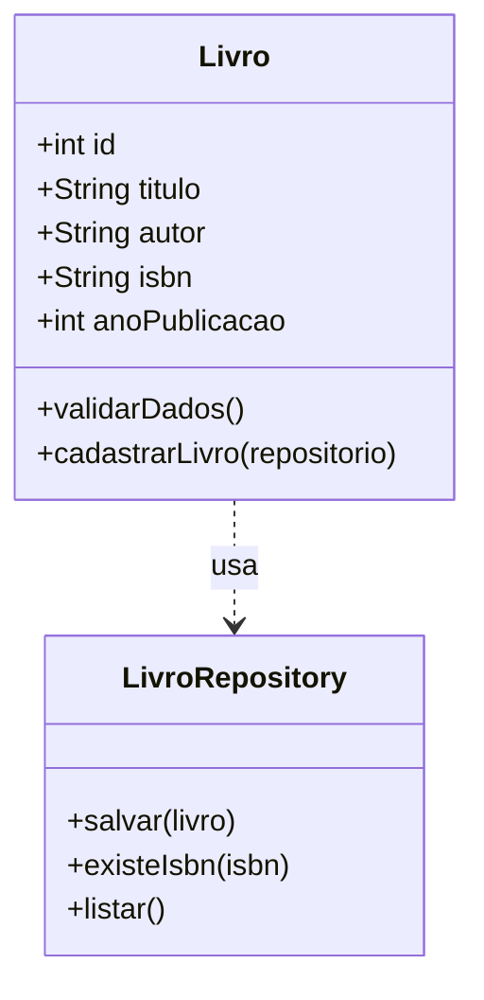

# Sistema de Gerenciamento de Biblioteca

**Atividade 03 — Desenvolvimento Ágil e Prática de XP**

| Item | Detalhe |
|---|---|
| User Story | US01 — Cadastrar Livros |
| Prioridade | Prioritária |
| Peso (planning poker) | 3 — complexidade média |

## 1. Objetivo

Implementar o cadastro de livros: o bibliotecário informa título, autor, ISBN e ano de publicação, o sistema valida os dados e salva o livro no navegador (`localStorage`), de forma que os cadastros continuam disponíveis depois de recarregar a página.

## 2. User Story

> **COMO** bibliotecário,
> **EU QUERO** cadastrar livros informando título, autor, ISBN e ano de publicação,
> **PARA QUE** os livros possam ser registrados e organizados no sistema.

## 3. Requisitos funcionais

| ID | Requisito |
|---|---|
| RF01 | O sistema deve permitir cadastrar um novo livro. |
| RF02 | O sistema deve solicitar título, autor, ISBN e ano de publicação. |
| RF03 | O sistema deve validar o preenchimento dos campos obrigatórios. |
| RF04 | O sistema deve impedir o cadastro de livros com ISBN duplicado. |
| RF05 | O sistema deve atribuir um identificador único a cada livro. |
| RF06 | O sistema deve informar se o cadastro foi realizado com sucesso ou se ocorreu algum erro. |

## 4. Regras de negócio

| ID | Regra |
|---|---|
| RN01 | Todos os campos são obrigatórios. |
| RN02 | O ISBN deve ser único para cada livro cadastrado. Hífens e espaços são ignorados na comparação (`978-85-359-1484-9` é igual a `9788535914849`). |
| RN03 | O ano de publicação deve ser um número inteiro positivo. |
| RN04 | Cada livro deve possuir um identificador único, gerado automaticamente pelo sistema. |
| RN05 | O sistema não deve salvar livros que não atendam às validações. |

## 5. Estrutura do projeto

```
biblioteca/
├── index.html              # formulário de cadastro
├── css/
│   └── style.css
├── js/
│   ├── app.js              # liga o formulário às classes (interface)
│   ├── Livro.js            # classe Livro, validações e mensagens
│   └── LivroRepository.js  # armazenamento no localStorage
├── tests/
│   ├── Livro.test.js           # validações, ISBN duplicado, critérios de aceitação
│   └── LivroRepository.test.js # persistência (simula recarregar a página)
├── package.json
└── README.md
```

### 5.1 Classe `Livro`

| Atributo | Tipo | Descrição |
|---|---|---|
| `id` | `int` | Identificador único (gerado pelo repositório ao salvar; começa `null`). |
| `titulo` | `String` | Título do livro. |
| `autor` | `String` | Nome do autor. |
| `isbn` | `String` | Código ISBN do livro. |
| `anoPublicacao` | `int` | Ano de publicação. |

| Método | Responsabilidade |
|---|---|
| `validarDados()` | Retorna a lista de erros de validação (lista vazia = dados válidos). |
| `cadastrarLivro(repositorio)` | Valida, verifica ISBN duplicado, salva e retorna `{ sucesso, mensagem }`. |

### 5.2 Classe `LivroRepository`

Responsável pelo armazenamento. Guarda a lista de livros em JSON no `localStorage`, sob a chave `biblioteca:livros`.

| Método | Responsabilidade |
|---|---|
| `salvar(livro)` | Gera o próximo `id`, grava no `localStorage` e define o `id` no livro. |
| `existeIsbn(isbn)` | Informa se já existe livro com esse ISBN (ignorando hífens e espaços). |
| `listar()` | Retorna os livros salvos (lista vazia se não houver dados ou se estiverem corrompidos). |

O `id` é calculado a partir dos livros já salvos (maior `id` + 1), por isso não se repete depois de recarregar a página.

### 5.3 Diagrama de classes



## 6. Fluxo do cadastro

1. O bibliotecário acessa a página de cadastro.
2. O sistema solicita os dados do livro.
3. O bibliotecário preenche as informações e clica em **Cadastrar**.
4. O sistema verifica se os campos estão preenchidos.
5. O sistema verifica se o ano informado é válido.
6. O sistema verifica se o ISBN já está cadastrado.
7. Caso os dados sejam válidos, o livro é salvo no `localStorage`.
8. O sistema apresenta uma mensagem de sucesso e limpa o formulário.
9. Caso alguma validação falhe, o sistema informa o erro e não realiza o cadastro.

## 7. Critérios de aceitação

| ID | Critério |
|---|---|
| CA01 | Um livro com todos os dados válidos deve ser cadastrado com sucesso. |
| CA02 | O sistema deve rejeitar cadastros com campos vazios. |
| CA03 | O sistema deve rejeitar ISBNs já cadastrados. |
| CA04 | O sistema deve rejeitar anos inválidos. |
| CA05 | Um cadastro bem-sucedido deve gerar uma mensagem de confirmação. |

## 8. Rastreabilidade

| Requisito | Regra de negócio | Critério de aceitação |
|---|---|---|
| RF01, RF05 | RN04 | CA01 |
| RF02, RF03 | RN01 | CA02 |
| RF04 | RN02 | CA03 |
| RF03 | RN03 | CA04 |
| RF06 | RN05 | CA05 |

## 9. Como executar

O projeto usa módulos ES (`type="module"`), que **não funcionam abrindo o `index.html` direto no navegador** (`file://`). É preciso servir a pasta por um servidor local:

```bash
# opção 1 (Python)
python -m http.server 8080

# opção 2 (Node)
npx serve .
```

Depois acesse `http://localhost:8080`.

Para conferir o armazenamento: cadastre um livro, abra as ferramentas do desenvolvedor (F12) → **Application** (Chrome/Edge) ou **Storage** (Firefox) → **Local Storage** → chave `biblioteca:livros`. Recarregue a página: os dados continuam lá.

> O `localStorage` é separado por endereço. Abrir por `localhost:8080` e depois por `localhost:5500` mostra listas diferentes.

## 10. Testes

Requer Node.js 18 ou superior. Não há dependências para instalar.

```bash
npm test
```

Os testes cobrem os critérios de aceitação CA01 a CA05, o formato do ISBN na checagem de duplicidade, a gravação em JSON, a persistência após "recarregar" (novo repositório sobre o mesmo storage), a continuidade dos ids, dados corrompidos no storage e falha ao gravar.
